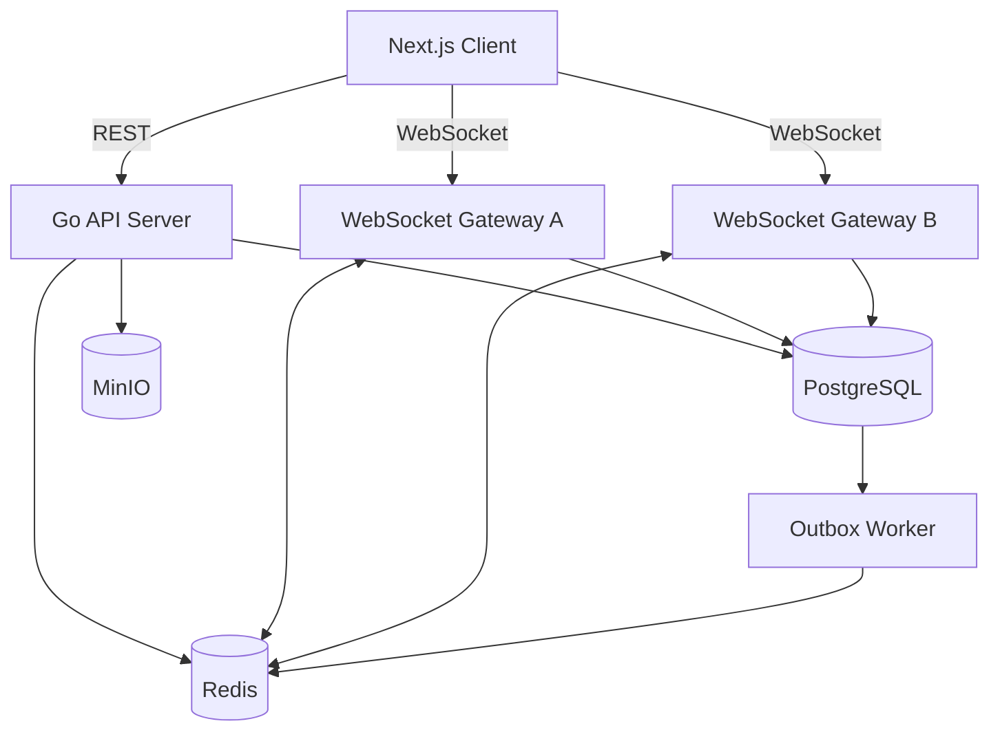

# Go Messaging Platform — Architecture

## 1. Project Overview

A real-time messaging and collaboration platform built to explore and demonstrate:

- Go backend engineering
- Concurrent programming
- WebSocket communication
- Distributed messaging
- Database design and optimization
- Horizontal scalability
- Reliability and observability

The initial implementation will use a modular monolith architecture. Components are logically separated but share one codebase and domain model.

## 2. Technology Stack

| Component | Technology | Responsibility |
|---|---|---|
| Backend | Go | Business logic and APIs |
| Frontend | Next.js, TypeScript | Web application |
| HTTP Router | Chi | REST API routing |
| WebSocket | coder/websocket | Real-time connections |
| Database | PostgreSQL | Persistent data |
| Database Access | pgx + SQLC | Database queries |
| Migration | golang-migrate | Schema migrations |
| Cache / Broker | Redis | Cache, presence, Pub/Sub |
| Object Storage | MinIO | File attachments |
| Infrastructure | Docker Compose | Local environment |
| Monitoring | Prometheus + Grafana | Metrics and dashboards |
| Load Testing | k6 | Performance testing |

## 3. High-Level Architecture

## 4. Backend Applications

### API Server

Responsibilities:

- User registration and authentication
- User profile and search
- Conversation and group management
- Message history and search
- Attachment metadata
- Application-level validation

### WebSocket Gateway

Responsibilities:

- Accept WebSocket connections
- Authenticate connected users
- Manage active connections
- Handle incoming real-time events
- Deliver messages to connected clients
- Handle typing indicators
- Handle delivery and read receipts
- Manage heartbeat and connection lifecycle

### Outbox Worker

A separate process introduced when the messaging flow is implemented.

Responsibilities:

- Read unpublished events from the outbox table
- Publish events to Redis
- Retry failed publishing attempts
- Mark successfully published events

All three applications will reuse shared internal packages. Business logic must not be duplicated between API Server and Gateway.

## 5. Message Delivery Flow

Example: User A sends a message to User B.

1. User A sends a message through WebSocket Gateway A.
2. Gateway A validates the request and authenticated user.
3. The application layer stores the message in PostgreSQL.
4. The same database transaction creates an outbox event.
5. Outbox Worker publishes the event to Redis.
6. Gateway B receives the event through Redis Pub/Sub.
7. Gateway B checks whether User B has an active connection.
8. If connected, Gateway B delivers the message.
9. User B acknowledges delivery or read status.

PostgreSQL remains the source of truth. Redis Pub/Sub is used for event distribution, not permanent message storage.

## 6. Reliability Strategy

Redis Pub/Sub does not guarantee that disconnected subscribers will receive missed events.

The application will therefore implement:

- Transactional Outbox for reliable database-to-event publishing.
- Message IDs for idempotency and duplicate detection.
- Client-side reconnect handling.
- Offline message synchronization from PostgreSQL.
- Delivery and read acknowledgements.
- Retry handling for transient failures.

We will not claim exactly-once delivery. The initial target is reliable persistence with at-least-once event publishing where applicable, and idempotent processing.

## 7. Redis Responsibilities

Redis will initially support:

- Pub/Sub for cross-gateway event distribution.
- User presence and gateway mapping.
- Connection heartbeat with TTL.
- Short-lived cache.

Redis is not the primary message database.

## 8. Local Distributed Simulation

Docker Compose will run:

- PostgreSQL
- Redis
- MinIO
- API Server
- WebSocket Gateway A
- WebSocket Gateway B
- Outbox Worker

Example gateway endpoints:

- Gateway A: `localhost:8081`
- Gateway B: `localhost:8082`

This allows us to test a message sent through one gateway and delivered through another.

## 9. Observability

We will expose metrics such as:

- Active WebSocket connections
- Messages received and delivered
- Message processing latency
- Database query latency
- Redis publishing failures
- WebSocket disconnects
- Application errors

Prometheus collects metrics and Grafana visualizes them.

## 10. Development Principles

- Keep the architecture simple initially.
- Use idiomatic Go.
- Prefer explicit dependencies.
- Write tests alongside implementation.
- Avoid premature microservices.
- Keep PostgreSQL as the source of truth.
- Measure performance before optimizing.
- Document important technical decisions.
