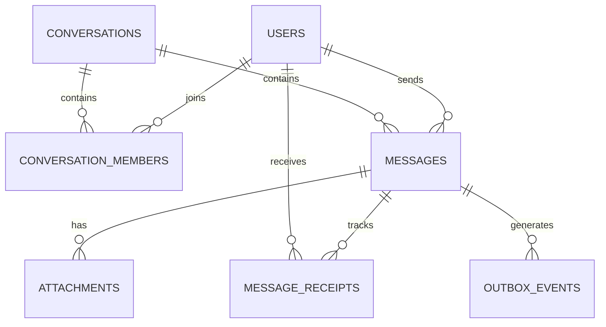

# Go Messaging Platform — Database Design

## 1. Database

PostgreSQL is the primary persistent data store.

Redis is used for temporary and distributed coordination data. It is not a replacement for PostgreSQL.

## 2. Initial Tables

### users

Stores registered user accounts.

| Column | Type | Notes |
|---|---|---|
| id | UUID | Primary key |
| email | VARCHAR | Unique, not null |
| password_hash | TEXT | Not null |
| username | VARCHAR | Unique, not null |
| display_name | VARCHAR | Not null |
| avatar_url | TEXT | Nullable |
| created_at | TIMESTAMPTZ | Not null |
| updated_at | TIMESTAMPTZ | Not null |

### conversations

Represents direct conversations and groups.

| Column | Type | Notes |
|---|---|---|
| id | UUID | Primary key |
| type | VARCHAR | `direct` or `group` |
| name | VARCHAR | Nullable for direct conversations |
| created_by | UUID | FK users.id |
| created_at | TIMESTAMPTZ | Not null |
| updated_at | TIMESTAMPTZ | Not null |

### conversation_members

Maps users to conversations.

| Column | Type | Notes |
|---|---|---|
| conversation_id | UUID | FK conversations.id |
| user_id | UUID | FK users.id |
| role | VARCHAR | `member` or `admin` |
| joined_at | TIMESTAMPTZ | Not null |
| last_read_message_id | UUID | Nullable |

Primary key: `(conversation_id, user_id)`.

### messages

Stores persistent messages.

| Column | Type | Notes |
|---|---|---|
| id | UUID | Primary key |
| conversation_id | UUID | FK conversations.id |
| sender_id | UUID | FK users.id |
| client_message_id | UUID | Client-generated idempotency key |
| type | VARCHAR | `text`, `image`, `file`, etc. |
| content | TEXT | Nullable |
| created_at | TIMESTAMPTZ | Not null |
| updated_at | TIMESTAMPTZ | Not null |
| deleted_at | TIMESTAMPTZ | Nullable |

Recommended constraint:

`UNIQUE(sender_id, client_message_id)`

This prevents a retried client request from creating duplicate messages.

Recommended index:

`(conversation_id, created_at DESC, id DESC)`

This supports paginated message history.

### attachments

Stores metadata for uploaded files.

| Column | Type | Notes |
|---|---|---|
| id | UUID | Primary key |
| message_id | UUID | FK messages.id |
| object_key | TEXT | MinIO object key |
| file_name | TEXT | Original filename |
| content_type | VARCHAR | MIME type |
| file_size | BIGINT | Size in bytes |
| created_at | TIMESTAMPTZ | Not null |

The actual file is stored in MinIO, not PostgreSQL.

### message_receipts

Tracks message delivery and read status per recipient.

| Column | Type | Notes |
|---|---|---|
| message_id | UUID | FK messages.id |
| user_id | UUID | FK users.id |
| delivered_at | TIMESTAMPTZ | Nullable |
| read_at | TIMESTAMPTZ | Nullable |

Primary key: `(message_id, user_id)`.

### outbox_events

Stores events that must be published after a database transaction commits.

| Column | Type | Notes |
|---|---|---|
| id | UUID | Primary key |
| aggregate_type | VARCHAR | Example: `message` |
| aggregate_id | UUID | Related entity ID |
| event_type | VARCHAR | Example: `message.created` |
| payload | JSONB | Event data |
| created_at | TIMESTAMPTZ | Not null |
| published_at | TIMESTAMPTZ | Nullable |
| attempts | INTEGER | Default 0 |

Recommended index:

`(created_at) WHERE published_at IS NULL`

The worker will claim pending records safely when multiple worker instances are running.

## 3. Entity Relationships

## 4. Important Design Decisions

### Message ordering

Use server-generated timestamps and a stable message ID as a tie-breaker when paginating. Do not rely on timestamps alone for strict ordering.

### Idempotency

The client generates a unique `client_message_id` for each message submission. A retry must reuse the same ID.

### Read receipts

A message can have different delivery and read states for different recipients. Therefore, receipts are stored per recipient.

### Direct conversations

A direct conversation must have exactly two active members. The application should prevent duplicate direct conversations between the same pair of users. A normalized participant-pair key or dedicated uniqueness strategy can be introduced during implementation.

### Outbox

The message insert and outbox event insert must happen in the same PostgreSQL transaction.

### Pagination

Use cursor-based pagination rather than large OFFSET queries for message history.

## 5. Future Tables

These are intentionally excluded from the first implementation:

- refresh_tokens
- user_sessions
- message_reactions
- message_pins
- conversation_settings
- blocked_users
- group_invites
- audit_logs

Add them when the corresponding feature is implemented.
